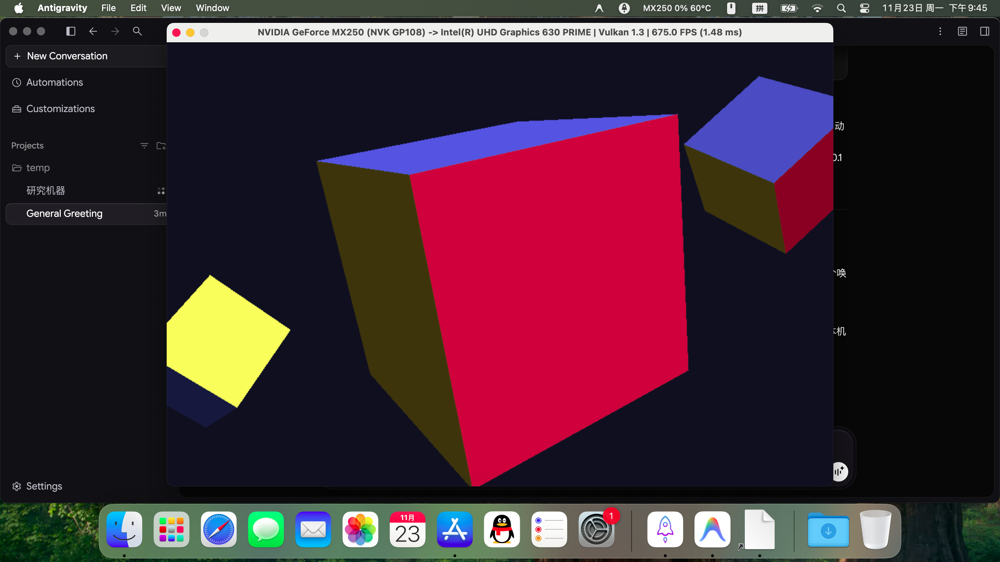
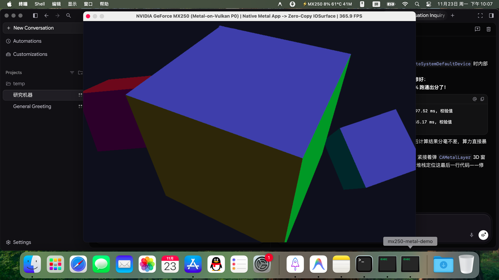

# mx250-macos-driver (v2.0.0)

**[English](README.md) | [简体中文](README_CN.md)**

**Full-Blood P0 Userspace RM Host, Vulkan 1.3 (`NVK/NAK`), Hardware Zero-Copy `IOSurface` Display Offload & SIP-Safe Metal-to-Vulkan Acceleration for NVIDIA GeForce MX250 (`GP108M`) on macOS Sequoia (`x86_64`)**

Bring discrete **NVIDIA Pascal (`GP108` / GeForce MX250, 2 GB GDDR5)** GPUs to full performance on modern macOS (`Darwin 24.x` / macOS Sequoia 15.x `x86_64`) — **with SIP & AMFI 100% enabled**, **0W `D3cold` battery-saving idle power**, and **hardware zero-copy `IOSurface` presentation** onto the integrated Intel UHD display.

<p align="center">
  
  
</p>
<p align="center">
  
  
  
</p>

---

## What's New in v2.0.0

1. **Full-Blood P0 Clocks & GDDR5 Training (`gp108-rmd` Userspace RM Host)**
   - Hosts NVIDIA's unmodified FreeBSD `x86_64` Resource Manager ELF core (`nv-kernel.o`, `470.256.02`) directly in macOS userspace (`< 2 GiB` `MAP_32BIT` VA space) atop `GP108Bridge.kext` — **zero proprietary binary patching, zero kernel panics, SIP & AMFI enabled**.
   - Unlocks signed PMU / ACR / SEC2 boost firmware and full **7008 Mbps GDDR5** memory link training:
     - **FP32 Compute**: `170.60 GFLOPS` -> **`979.82 GFLOPS`** (**5.74x** speedup; **2.35x** faster than Intel UHD 620)
     - **GDDR5 Bandwidth**: `5.48 GB/s` -> **`49.28 GB/s`** (**9.00x** speedup; 88% of theoretical wire limit)
     - **PCIe Gen3 x4 DMA**: `0.84 GB/s` -> **`3.31 GB/s`** (**3.94x** speedup)
2. **Hardware Zero-Copy `IOSurface` Swapchain Presentation (`708.54 FPS`)**
   - Pins triple-buffered macOS `IOSurfaceRef` physical DDR4 pages directly into GP108's MMU (`NV01_MEMORY_SYSTEM_OS_DESC` + `CACHE_SNOOP_ENABLE`).
   - MX250 renders in `49.3 GB/s` GDDR5 `BlockLinear` VRAM, hardware-untiles via `PASCAL_DMA_COPY_B` (`0xc1b5`) over PCIe Gen3 x4 straight into `IOSurface` physical pages, and hands the `IOSurfaceRef` directly to `WindowServer` (`CALayer.contents`) — **`0` CPU `memcpy` and `0` Intel `MTLBlitCommandEncoder` blit**, boosting `960×640` windowed 3D from `132.25 FPS` to **`708.54 FPS` (`1.41 ms/frame`)**.
3. **SIP-Safe Userspace Metal-to-Vulkan Interposer (`libmx250_metal.dylib` + `mx250-metal-run`)**
   - Runs unmodified macOS `Metal.framework` compute & `CAMetalLayer` 3D apps on Full-Blood P0 MX250 via Mach-O `__DATA,__interpose` with SIP enabled.
   - Extracts AIR bitcode in-process via macOS `GPUCompiler.framework/libLLVM.dylib`, dynamically translates AIR -> Vulkan 1.3 SPIR-V (`libnvmtl_translate.dylib`), executes on Mesa NVK `SM61`, and presents via Zero-Copy `IOSurface` (**`845.99 GFLOPS`** native Metal FP32 compute — **3.65x** faster than Intel UHD 620 — and **`395 FPS`** `CAMetalLayer` 3D).
4. **On-Demand `0W` `D3cold` Power Management (Mode B)**
   - Defaults to `ACPI _OFF` (`D3cold`, **`0.0 W`** battery draw) at boot and after laptop sleep/wake.
   - Automatically wakes MX250 into Full-Blood `P0` in `~1.5 s` whenever any Vulkan or `mx250-metal-run` client starts, and powers back down to `0W` `D3cold` after 60 seconds of idle (`GP108_IDLE_OFF_SEC`).

---

## Architecture

```
┌──────────────────────────────────────────────────────────────────────────────┐
│ Native macOS Metal Apps (via mx250-metal-run)  │  Native Vulkan 1.3 Apps     │
│   └── libmx250_metal.dylib (__DATA,__interpose + Zero-Copy CAMetalLayer)     │
│       └── AIR Bitcode -> libLLVM.dylib -> libnvmtl_translate.dylib (SPIR-V)  │
├────────────────────────────────────────────────┴─────────────────────────────┤
│ Mesa 26.3.1 NVK + NAK (Rust SM61 SASS Compiler) + Zero-Copy IOSurface WSI    │
│   ├── nvkmd_macos + libgp108_rm_bridge.a (Unix Socket + SCM_RIGHTS shm)      │
│   └── wsi_common_metal: GDDR5 BlockLinear -> 0xc1b5 DMA -> IOSurfaceRef      │
├─────────────────────────── /tmp/gp108_rmd.sock ──────────────────────────────┤
│ gp108-rmd (On-Demand Userspace NVIDIA 470.256.02 RM Host Daemon)             │
│   ├── elf64_rm_loader.c + macos_nv_os.c (0 binary patches, <2 GiB VA map)    │
│   └── Full-Blood P0 Boost, Per-Client FERMI_VASPACE_A, Idle -> ACPI _OFF 0W  │
├─────────────────────────── Mach / IOKit UserClient ──────────────────────────┤
│ GP108Bridge.kext (Minimal ~800-LOC XNU PCIe / MMIO / PinUserMem / MSI Bridge)│
└──────────────────────────────────────────────────────────────────────────────┘
```

---

## Live Hardware Benchmarks (macOS Sequoia 15.8.3, Core i5-10210U + MX250 2GB)

| Benchmark | v1.1 Boot Clocks (`nvkm`) | Intel UHD 620 iGPU | **v2.0 Full-Blood P0 MX250** | Speedup |
| :--- | :---: | :---: | :---: | :---: |
| **Core / GDDR5 Clocks** | `531 MHz` / `405 MHz` | Shared DDR4 | **`1296 MHz` / `3504 MHz` (`7008 Mbps`)** | **Full P0** |
| **Vulkan FP32 Compute** (`mx250-bench`) | `170.60 GFLOPS` | `416.80 GFLOPS` | **`979.82 GFLOPS`** | **5.74x** (`2.35x` vs iGPU) |
| **GDDR5 VRAM Bandwidth** | `5.48 GB/s` | ~`21.0 GB/s` | **`49.28 GB/s`** | **9.00x** |
| **PCIe Gen3 x4 DMA (`VRAM->Host`)** | `0.84 GB/s` | — | **`3.31 GB/s`** | **3.94x** |
| **Vulkan 3D Desktop Window (`960×640`)** | `132.25 FPS` (`MTLBlit`) | — | **`708.54 FPS` (`1.41 ms/frame`)** | **5.36x (Zero-Copy)** |
| **Native `Metal.framework` FP32 Compute** | — | `230.02 GFLOPS` | **`845.99 GFLOPS`** (exact match) | **3.68x vs iGPU** |
| **Native `Metal` `CAMetalLayer` 3D (`960×640`)** | — | — | **`395.14 FPS` (`2.53 ms/frame`)** | **Zero-Copy IOSurface** |
| **Idle Power Consumption (Mode B)** | `~5 W` (D0) | — | **`0.0 W` (`D3cold` ACPI `_OFF`)** | **Zero Idle Drain** |

---

## Daily CLI & Menu Bar Usage

* **`mx250-smi`** — Inspect current power state (`D3off 0W` or `Full P0 1296 MHz / 7008 Mbps`), die temperature, GDDR5 VRAM usage, and active GPU processes.
* **`mx250-bench`** — Run Vulkan 1.3 FP32 GFLOPS, GDDR5 VRAM bandwidth, and PCIe Gen3 x4 DMA benchmark (auto-wakes MX250 from `0W` if sleeping).
* **`mx250-metal-run <app-binary> [args...]`** — Run a native macOS `Metal.framework` app on Full-Blood P0 MX250 with Zero-Copy `IOSurface` presentation (`SIP` enabled):
  ```sh
  mx250-metal-run mx250-metal-demo 5.0
  ```
* **`MX250 Monitor` (Menu Bar Item)** — Displays `MX250 0W` while powered off in `D3cold` and switches live to `⚡MX250 P0 XX% XX°C` when active, with 1-click Metal 3D demo launch and instant `0W` sleep toggle.

---

## Repository Layout

* `kext/` — `GP108Bridge.kext` IOKit PCIe / MMIO / scatter-gather user-page pinning / MSI interrupt / ACPI `_ON`/`_OFF` bridge
* `include/` — Shared kernel-userspace ABI (`GP108BridgeShared.h`) & lock-free P0 telemetry page (`GP108TelemetryShared.h`)
* `rm_macos/` — Userspace ELF64 loader (`elf64_rm_loader.c`), Darwin `os-interface` implementation (`macos_nv_os.c`), on-demand P0 daemon (`gp108_rmd.c`), NVK IPC bridge (`gp108_nvk_bridge_rm.c`), and MIT NVIDIA Open-GPU SDK headers (`sdk_inc/`)
* `mesa_macos/` & `patches/` — macOS `nvkmd` backend + Hardware Zero-Copy `IOSurface` WSI swapchain patch against **Mesa `26.3.1`**
* `nvkm_macos/` — Standalone Darwin userspace Nouveau fallback (`libnvkm_gp108.a`)
* `tools/` — SIP-safe Metal-to-Vulkan interposer (`mx250_metal_interpose.m`, `mx250-metal-run`, `mx250_metal_demo.m`), `mx250-bench`, `nvidia-smi`, and `MX250 Monitor` menu bar app

## License

* Original macOS kernel bridge, userspace RM host loader/daemon, `nvkmd_macos`, Zero-Copy WSI integration, Metal-to-Vulkan interposer, and CLI/Cocoa utilities (`kext/`, `include/`, `rm_macos/`, `mesa_macos/`, `tools/`): **MIT License**
* `rm_macos/sdk_inc/`: **MIT License** (from upstream NVIDIA `open-gpu-kernel-modules` SDK headers)
* Linux `nouveau/nvkm` fallback (`nvkm_macos/`): **MIT / GPL-2.0**
* `firmware/nvidia/gp108/`: Upstream `linux-firmware` NVIDIA redistribution license (`LICENCE.nvidia`). Note: `nv-kernel.o` (`NVIDIA-FreeBSD-x86_64-470.256.02`) and external LGPL-3.0 `libnvmtl_translate.dylib` are **not** bundled in this git repository; `gp108-rmd` loads `nv-kernel.o` unmodified at runtime from `~/Library/Application Support/NVIDIA-GP108/firmware/nv-kernel.o`, and `libmx250_metal.dylib` loads `libnvmtl_translate.dylib` dynamically via `dlopen`.
