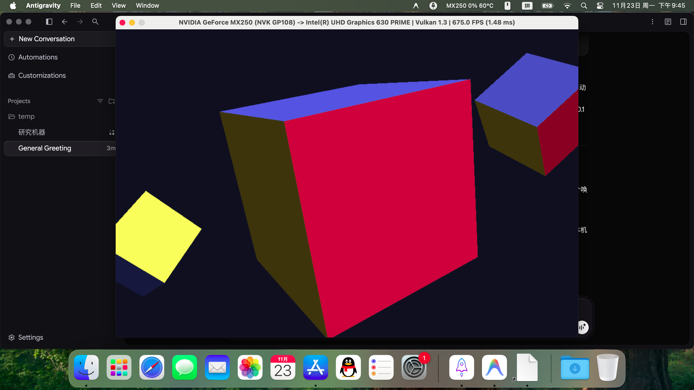
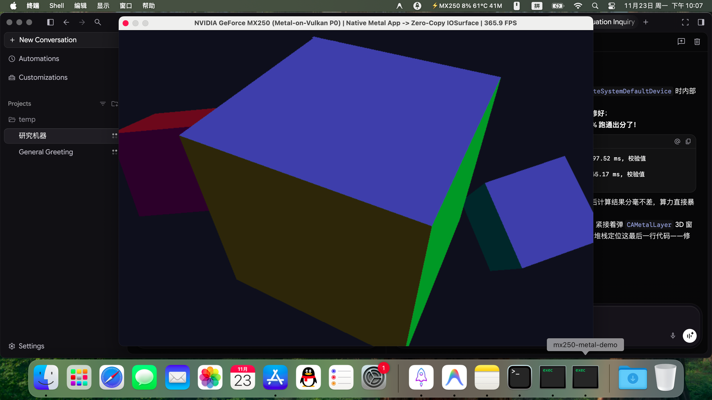

# mx250-macos-driver (v2.0.0)

**[English](README.md) | [简体中文](README_CN.md)**

**面向 macOS Sequoia (`x86_64`) 的 NVIDIA GeForce MX250 (`GP108M`) 满血 P0 用户态 RM 宿主、Vulkan 1.3 (`NVK/NAK`)、硬件级 `IOSurface` 零拷贝上屏与免关 SIP 的 Metal-to-Vulkan 转译加速驱动栈**

无需关闭 **SIP / AMFI**，不影响核显（Intel UHD 620）驱动 `WindowServer` 原生 HiDPI 桌面，在现代 macOS（`Darwin 24.x` / macOS Sequoia 15.x `x86_64`）上彻底释放 **NVIDIA Pascal 架构独显（`GP108` / GeForce MX250, 2 GB GDDR5）** 的满血算力与 3D 渲染性能，并支持笔记本日常 **`0W` (`D3cold`) 断电省电、用时 `~1.5s` 自动唤醒满血**。

<p align="center">
  
  
</p>
<p align="center">
  
  
  
</p>

---

## v2.0.0 核心突破

1. **解锁满血 P0 睿频与 GDDR5 高频链路训练（`gp108-rmd` 用户态 RM 宿主）**
   - 在极简 IOKit 硬件桥 `GP108Bridge.kext` 之上，直接在 macOS 用户态低地址空间（`< 2 GiB`）原封不动加载官方 FreeBSD `x86_64` ELF 核心（`nv-kernel.o`, `470.256.02`）——**零二进制补丁、零内核崩溃风险、全程开启 SIP 与 AMFI**。
   - 完整加载 PMU / ACR / SEC2 官方签名固件并完成 **7008 Mbps GDDR5** 显存训练：
     - **FP32 单精度算力**：`170.60 GFLOPS` -> **`979.82 GFLOPS`**（提升 **5.74 倍**，为核显 Intel UHD 620 的 **2.35 倍**）
     - **GDDR5 显存带宽**：`5.48 GB/s` -> **`49.28 GB/s`**（提升 **9.00 倍**，达硬件物理极限的 88%）
     - **PCIe Gen3 x4 DMA 带宽**：`0.84 GB/s` -> **`3.31 GB/s`**（提升 **3.94 倍**）

2. **硬件级 `IOSurface` 物理页零拷贝跨 GPU 上屏（`708.54 FPS`）**
   - 通过 `NV01_MEMORY_SYSTEM_OS_DESC` 将 macOS 三缓冲 `IOSurfaceRef` 的 DDR4 物理内存页直接锁页映射进 GP108 的 GPU 页表（开启 PCIe Cache Snoop）。
   - MX250 在 `49.3 GB/s` 的 GDDR5 `BlockLinear` 显存内完成渲染后，由硬件拷贝引擎 `PASCAL_DMA_COPY_B` (`0xc1b5`) 硬件解块并经 PCIe Gen3 x4 DMA 直写 `IOSurface` 物理页，直接赋值给 `CALayer.contents` 交由 `WindowServer` 合成上屏——**`0` 次 CPU `memcpy`、`0` 次核显 `MTLBlitCommandEncoder` 二次拷贝**，使 `960×640` 桌面 3D 帧率从 `132.25 FPS` 暴涨至 **`708.54 FPS`（`1.41 ms/帧`）**。

3. **免关 SIP 的用户态 Metal-to-Vulkan 转译加速层（`libmx250_metal.dylib` + `mx250-metal-run`）**
   - 通过 Mach-O `__DATA,__interpose` 机制拦截应用层 `MTLCreateSystemDefaultDevice` / `MTLCopyAllDevices`（自动识别并放行 `/System/Library/` 系统 UI 框架继续走核显），无需关闭 SIP 即可将原生 `Metal.framework` 应用重定向至满血 MX250。
   - 进程内调用系统自带 `GPUCompiler.framework/libLLVM.dylib` 提取 AIR 位码，动态加载 `libnvmtl_translate.dylib` 实时转译为 Vulkan 1.3 SPIR-V 交由 Mesa NVK `SM61` 编译执行，并同样通过 `IOSurface` 零拷贝上屏（实测原生 Metal FP32 算力达 **`845.99 GFLOPS`**，为核显的 **3.68 倍**；原生 `CAMetalLayer` 3D 窗口达 **`395.14 FPS`**）。

4. **按需自动唤醒与日常 `0W` `D3cold` 极致省电（方式 B）**
   - 开机登录及笔记本盒盖休眠唤醒后默认切入 `ACPI _OFF`（`D3cold` 彻底断电，待机功耗 **`0.0 W`**）。
   - 当启动任何 Vulkan 程序或 `mx250-metal-run` 时，底层自动在 `~1.5 秒` 内拉起 `gp108-rmd` 完成上电与满血 P0 初始化；程序退出空闲满 60 秒后（可通过 `GP108_IDLE_OFF_SEC` 配置），自动卸载 RM、切回 `0W` 断电并退出后台。

---

## 系统架构图

```
┌──────────────────────────────────────────────────────────────────────────────┐
│ 原生 macOS Metal 应用 (通过 mx250-metal-run)  │  原生 Vulkan 1.3 应用 / 计算 │
│   └── libmx250_metal.dylib (__DATA,__interpose 注入 + 零拷贝 CAMetalLayer)   │
│       └── AIR Bitcode -> libLLVM.dylib -> libnvmtl_translate.dylib (SPIR-V)  │
├───────────────────────────────────────────────┴──────────────────────────────┤
│ Mesa 26.3.1 NVK + NAK (Rust SM61 编译器) + 硬件零拷贝 IOSurface WSI 交换链   │
│   ├── nvkmd_macos + libgp108_rm_bridge.a (Unix Socket + SCM_RIGHTS 共享内存) │
│   └── wsi_common_metal: GDDR5 BlockLinear -> 0xc1b5 硬件解块 DMA -> IOSurface│
├─────────────────────────── /tmp/gp108_rmd.sock ──────────────────────────────┤
│ gp108-rmd (按需自启用户态 NVIDIA 470.256.02 官方 RM 宿主守护进程)            │
│   ├── elf64_rm_loader.c + macos_nv_os.c (零二进制修改，<2 GiB 地址空间映射)  │
│   └── 满血 P0 锁频、每进程独立 FERMI_VASPACE_A 隔离、空闲自动 ACPI _OFF (0W) │
├─────────────────────────── Mach / IOKit UserClient ──────────────────────────┤
│ GP108Bridge.kext (约 800 行极简 XNU 内核桥：MMIO / 物理页锁定 / MSI / ACPI)  │
└──────────────────────────────────────────────────────────────────────────────┘
```

---

## 真机实测数据对比（macOS Sequoia 15.8.3, Core i5-10210U + MX250 2GB）

| 测试项目 | v1.1 初始频率 (`nvkm`) | Intel UHD 620 核显 | **v2.0 满血 P0 MX250** | 性能提升 |
| :--- | :---: | :---: | :---: | :---: |
| **核心 / GDDR5 显存频率** | `531 MHz` / `405 MHz` | 共享系统 DDR4 | **`1296 MHz` / `3504 MHz` (`7008 Mbps`)** | **满血 P0** |
| **Vulkan FP32 算力** (`mx250-bench`) | `170.60 GFLOPS` | `416.80 GFLOPS` | **`979.82 GFLOPS`** | **5.74x**（核显的 `2.35x`） |
| **GDDR5 显存带宽** | `5.48 GB/s` | ~`21.0 GB/s` | **`49.28 GB/s`** | **9.00x** |
| **PCIe Gen3 x4 DMA (`VRAM->Host`)** | `0.84 GB/s` | — | **`3.31 GB/s`** | **3.94x** |
| **Vulkan 3D 桌面窗口 (`960×640`)** | `132.25 FPS` (`MTLBlit`) | — | **`708.54 FPS` (`1.41 ms/帧`)** | **5.36x（零拷贝上屏）** |
| **原生 `Metal.framework` FP32 算力** | — | `230.02 GFLOPS` | **`845.99 GFLOPS`**（结果逐位一致） | **核显的 3.68x** |
| **原生 `Metal` `CAMetalLayer` 3D (`960×640`)** | — | — | **`395.14 FPS` (`2.53 ms/帧`)** | **IOSurface 零拷贝** |
| **日常空闲功耗（方式 B）** | `~5 W` (D0) | — | **`0.0 W` (`D3cold` ACPI `_OFF`)** | **零待机额外耗电** |

---

## 日常终端命令与状态栏监控

* **`mx250-smi`** — 查看 MX250 当前电源状态（`D3off 0W` 或 `Full P0 1296 MHz / 7008 Mbps`）、核心温度、显存占用与活跃独显进程。
* **`mx250-bench`** — 一键从 `0W` 自动唤醒并测试满血 Vulkan 1.3 FP32 算力、GDDR5 带宽与 PCIe Gen3 x4 DMA 速率。
* **`mx250-metal-run <可执行文件> [参数...]`** — 免关 SIP 将原生 macOS `Metal.framework` 程序跑在满血 MX250 上并零拷贝上屏：
  ```sh
  mx250-metal-run mx250-metal-demo 5.0
  ```
  > 提示：若第三方 App 带有 Hardened Runtime 强签名限制，只需对其副本执行一次 `codesign -f -s - <App路径>`（无需关 SIP），即可通过 `mx250-metal-run` 注入运行。
* **右上角 `MX250` 状态栏监控** — 断电休眠时显示 `MX250 0W`（零内核句柄占用），独显工作时自动显示 `⚡MX250 P0 XX% XX°C`，支持一键启动 Metal 3D 演示与一键立即断电休眠。

---

## 目录结构说明

* `kext/` — `GP108Bridge.kext` 内核硬件桥（BAR0/1/3 映射、用户态物理页散列锁定、MSI 中断、ACPI `_ON`/`_OFF` 电源控制）
* `include/` — 内核与用户态共享协议头（`GP108BridgeShared.h`）及无锁 P0 遥测共享页定义（`GP108TelemetryShared.h`）
* `rm_macos/` — 用户态 ELF64 重定位加载器（`elf64_rm_loader.c`）、Darwin `os-interface` 适配层（`macos_nv_os.c`）、按需 P0 守护进程（`gp108_rmd.c`）、NVK 通信桥（`gp108_nvk_bridge_rm.c`）与 MIT 协议 NVIDIA Open-GPU SDK 头文件（`sdk_inc/`）
* `mesa_macos/` & `patches/` — 针对 **Mesa `26.3.1`** 的 macOS `nvkmd` 后端与 `IOSurface` 物理页零拷贝 WSI 交换链补丁
* `nvkm_macos/` — 纯开源 Nouveau `nvkm` 用户态后备栈（`libnvkm_gp108.a`）
* `tools/` — 免关 SIP 的 Metal-to-Vulkan 转译层（`mx250_metal_interpose.m`、`mx250-metal-run`、`mx250_metal_demo.m`）、`mx250-bench`、`nvidia-smi` 与状态栏监控源码

## 开源许可说明

* 本项目自研内核桥、用户态 RM 加载与宿主守护进程、`nvkmd_macos`、零拷贝 WSI 集成、Metal-to-Vulkan 转译加速层及命令行/状态栏工具（`kext/`、`include/`、`rm_macos/`、`mesa_macos/`、`tools/`）：**MIT License**
* `rm_macos/sdk_inc/`：**MIT License**（源自上游 NVIDIA `open-gpu-kernel-modules` 开源 SDK 头文件）
* Linux `nouveau/nvkm` 后备层（`nvkm_macos/`）：**MIT / GPL-2.0**
* `firmware/nvidia/gp108/`：遵循上游 `linux-firmware` 的 NVIDIA 二进制重分发许可（`LICENCE.nvidia`）。注：本仓库**不包含**任何专有闭源二进制文件（`nv-kernel.o`）或外部 LGPL 动态库（`libnvmtl_translate.dylib`）；`gp108-rmd` 在运行时从本机 `~/Library/Application Support/NVIDIA-GP108/firmware/nv-kernel.o` 原样加载 `nv-kernel.o`，`libmx250_metal.dylib` 通过 `dlopen` 动态加载 `libnvmtl_translate.dylib`。
